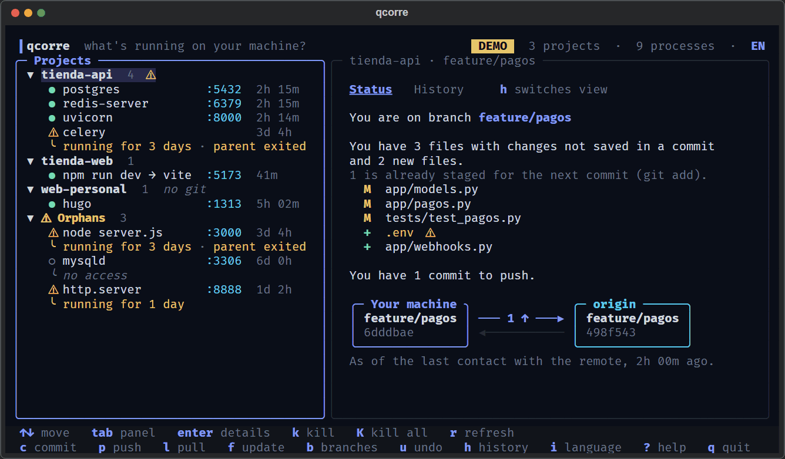

# qcorre

**What's running on your machine?** A developer dashboard for the terminal.

English · [Español](README.md)

*qcorre* is short for the Spanish "¿qué corre?" — "what's running?".

<!-- Once the GIF exists:  -->

```
▍qcorre  what's running on your machine?                  3 projects · 9 processes · EN
╭─ Projects ───────────────────────────╮╭─ tienda-api · feature/pagos ─────────────────╮
│ ▼ tienda-api  4  ⚠                   ││ Status   History      h switches view        │
│    ● postgres      :5432  2h 15m     ││                                              │
│    ● redis-server  :6379  2h 15m     ││ You are on branch feature/pagos              │
│    ● uvicorn       :8000  2h 14m     ││                                              │
│    ⚠ celery               3d 4h      ││ You have 3 files with changes not saved in   │
│      ╰ running for 3 days · its pa…  ││ a commit and 2 new files.                    │
│ ▼ tienda-web  1                      ││                                              │
│    ● npm run dev → vite  :5173  41m  ││ ╭─ Your machine ─╮          ╭─ origin ──────╮│
│ ▼ ⚠ Orphans  3                       ││ │ feature/pagos  │ ── 1 ↑ ─►│ feature/pagos ││
│    ⚠ node server.js  :3000  3d 4h    ││ │ 3400d6e        │ ◄─────── │ 487c736       ││
╰──────────────────────────────────────╯╰──────────────────────────────────────────────╯
 ↑↓ move   tab panel   enter details   k kill   K kill all   r refresh
 c commit   p push   l pull   f update   b branches   u undo   h history   ? help
```

## What it does

**Processes by project.** It finds your servers, databases and dev tools, with
their ports, and groups them by the git repo (or project folder) they run from.

- A server and its child processes show up as a single row
  (`npm run dev → vite`).
- It flags **orphans**: processes with no project, running for more than a day,
  or whose parent process has exited.
- Kill one process or every process of a project, always behind a confirmation
  that lists exactly what will be closed.

**Git in plain language**, for the selected project.

- **Explained status:** "You have 3 files with changes not saved in a commit".
- **Your machine ↔ remote map:** how many commits you have to push and to pull.
- **Actions with a preview:** commit, push, pull, update from remote, branches
  and undo. Before each one you see what will happen and the exact git command.
  Nothing runs without confirming.
- **Safety net:** before a risky action a backup is saved (under
  `refs/qcorre/backup/`) that you can go back to.
- **History** as a coloured branch graph.

The interface is available in Spanish and English (key `i`).

## Installation

You need Python 3.10 or newer and `git` installed. It works on Windows, macOS
and Linux.

qcorre isn't published on PyPI yet. Meanwhile, install it from the repository:

```bash
pipx install git+https://github.com/BryanGEP/qcorre
# or, without installing anything permanently:
uvx --from git+https://github.com/BryanGEP/qcorre qcorre
```

Once it is on PyPI, `pipx install qcorre` or `uvx qcorre` will be enough.

## Usage

```bash
qcorre                    # opens the dashboard; the current folder's project is always listed
qcorre path/to/project    # same, pinning another project
qcorre --demo             # simulated data: try everything without touching anything real
qcorre --lang en          # force the language (es / en)
qcorre --orphan-hours 8   # flag as orphan anything running for more than 8 hours
```

`qcorre --demo` opens the full interface over fake processes and repos that
react to your actions. It is the quickest way to get to know it.

### Keys

| Key | What it does |
|---|---|
| `↑` `↓` | Move through projects and processes |
| `tab` | Switch panel |
| `enter` | Process details (full command, folder, PID, parent) |
| `k` / `K` | Kill the process / every process of the project |
| `r` | Refresh now (it also refreshes on its own every 3 s) |
| `c` | Save the changes in a commit |
| `p` / `l` | Push / pull |
| `f` | Update from the remote (fetch) |
| `b` | Branches: switch, create (`n`) or delete a merged one (`d`) |
| `u` | Undo: the last commit, your changes, or go back to a backup |
| `h` | Toggle between status and history |
| `a` | See every changed file |
| `i` | Switch language |
| `?` | Help |
| `q` | Quit |

## How it decides which project a process belongs to

In order: the process's working directory, the paths on its command line, the
path of its executable and, if none of that helps, its parent process's project.
From that folder it walks up looking for a `.git`; if there is no repo, the
nearest folder with a project file counts (`package.json`, `pyproject.toml`,
`Cargo.toml`, `go.mod`…).

Processes the system won't let it read (very common on Windows with service
processes) are still shown, marked as **no access**.

## What it does and doesn't do to your repo

qcorre uses your system's `git`, so anything it does is something you could type
yourself. It is designed not to surprise you:

- **Pull** only moves forward when nothing needs merging (`--ff-only`).
- It **never** force-pushes or runs `git branch -D`.
- **Undoing a commit** keeps its changes, and is only offered while that commit
  isn't on the remote yet.
- **Commit** saves every change (`git add -A`), lists the files going in and
  warns you if any of them looks like it contains secrets (`.env`, `*.pem`,
  `id_rsa`…).
- It never asks for passwords: if the remote needs you to sign in, it tells you
  and you do it from your terminal.
- While you are only looking, it touches nothing: neither the network nor the
  repo's index.

Backups are ordinary git refs. List them with
`git for-each-ref refs/qcorre/backup` and delete one with
`git update-ref -d <ref>`.

### Limitations

- It doesn't resolve conflicts, merge or rebase. If your branch and the remote
  have diverged, it explains that and leaves the fix to you.
- The backup of unsaved changes doesn't include new files git isn't tracking yet.
- Docker containers show up as Docker processes, with no project.
- A branch that was *squash*-merged on GitHub doesn't count as merged for git,
  so deleting it isn't offered.

## Development

```bash
git clone https://github.com/BryanGEP/qcorre
cd qcorre
python -m venv .venv
# Windows: .venv\Scripts\activate    macOS/Linux: source .venv/bin/activate
pip install -e ".[dev]"

pytest             # tests (logic, git against temporary repos, and the interface)
ruff check .       # lint
qcorre --demo      # the interface with simulated data
```

The code is split into layers so the logic can be tested without the interface.
Code comments and docstrings are written in Spanish.

| Folder | Responsibility |
|---|---|
| `src/qcorre/collectors/` | Read processes and ports from the system (psutil) and close them |
| `src/qcorre/projects/` | Decide each process's project and group them (pure logic) |
| `src/qcorre/git/` | Read the repo, prepare and run actions, backups, history |
| `src/qcorre/ui/` | The interface (Textual). Presentation only |
| `src/qcorre/i18n/` | Spanish and English texts |
| `src/qcorre/demo.py` | The simulated world behind `--demo` |

To record the showcase GIF, open `qcorre --demo` in a terminal of about
120×34 columns: the simulated data reacts to actions (killing a process, commit,
push, branches, history), so the walkthrough can be repeated as many times as
needed without touching anything real.

Changes are described in [CHANGELOG.md](CHANGELOG.md) (in Spanish).

## License

[MIT](LICENSE)
