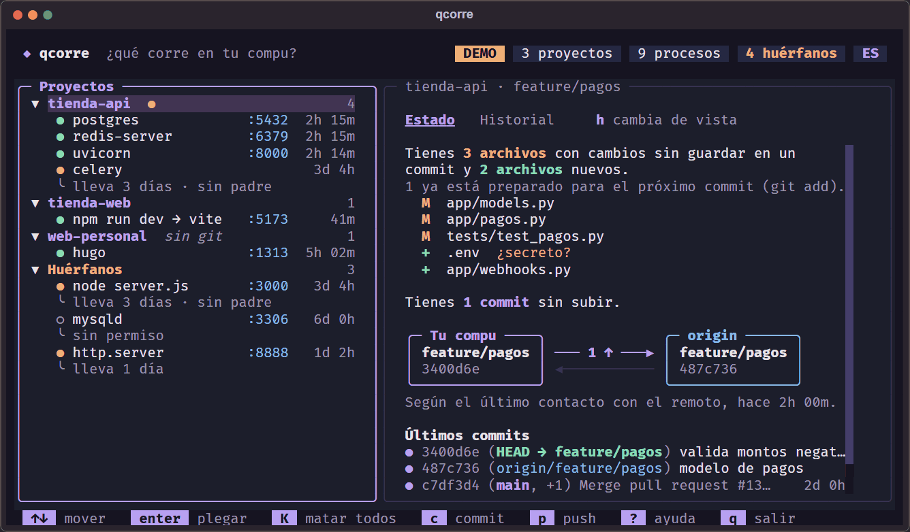
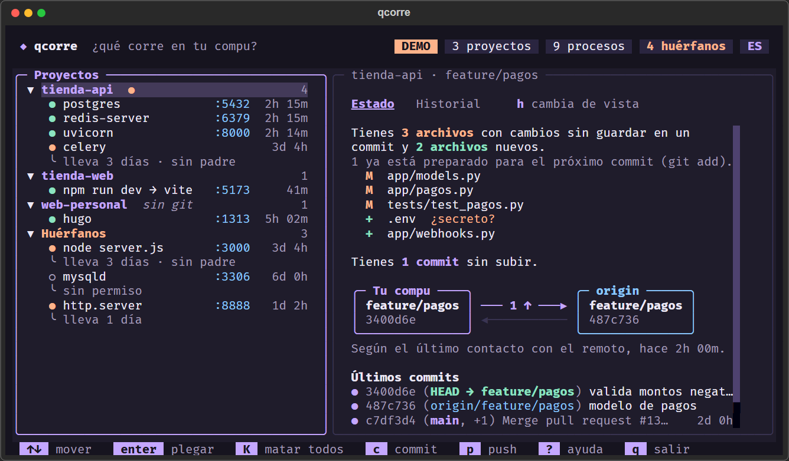
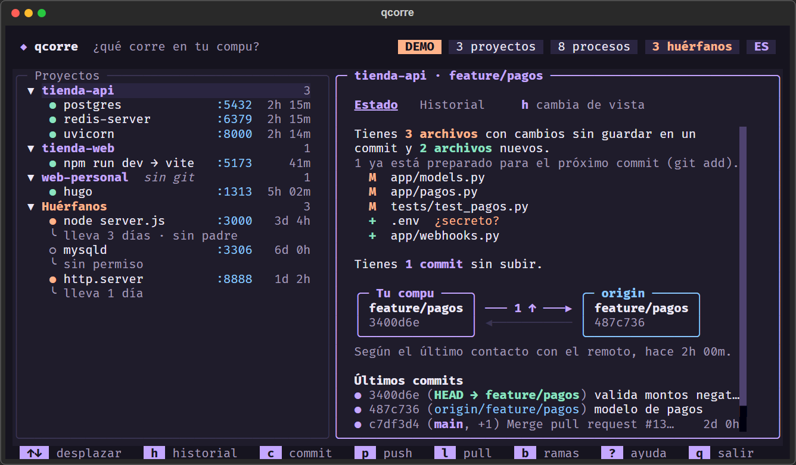
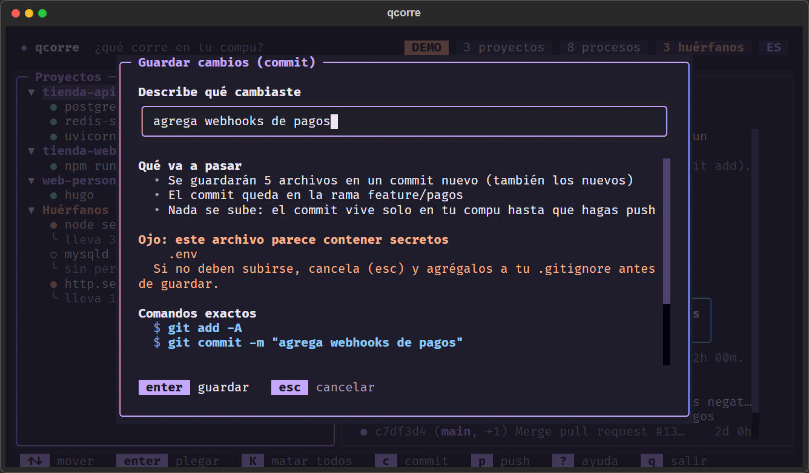
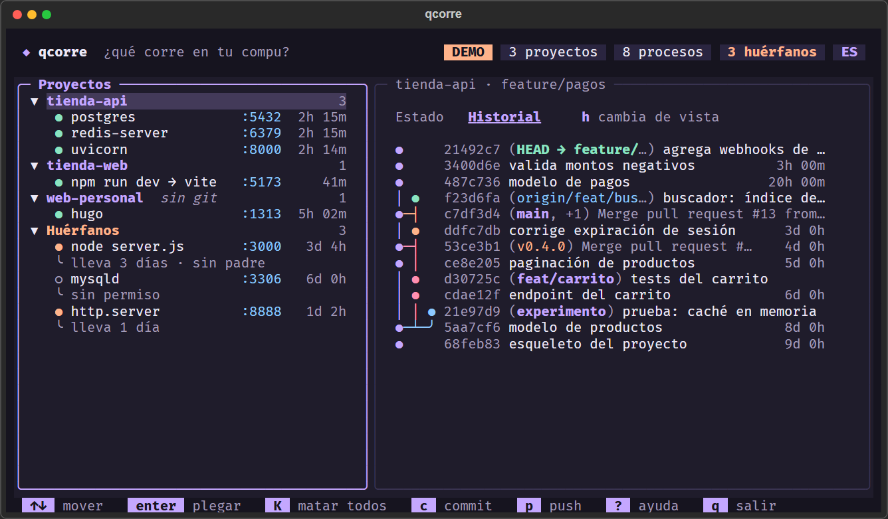

<h1 align="center">qcorre</h1>

<p align="center">
  <strong>Mira qué corre en tu compu, agrupado por proyecto, y usa git en lenguaje humano.</strong><br>
  Un panel para desarrolladores en la terminal. Funciona en Windows, macOS y Linux.
</p>

<p align="center">
  <a href="https://pypi.org/project/qcorre/"></a>
  <a href="https://github.com/BryanGEP/qcorre/actions/workflows/ci.yml"></a>
  <a href="LICENSE"></a>
  
  
</p>

<p align="center">
  <a href="README.md">English</a> · Español
</p>

<p align="center">
  
</p>

> *qcorre* viene de **"¿qué corre?"**: qué está corriendo en tu compu.

## ¿Por qué qcorre?

- **"¿Qué sigue usando el puerto 3000?"** Los servidores, bases de datos y
  herramientas de desarrollo se acumulan entre proyectos. qcorre los lista por
  proyecto, con sus puertos, para ver de un vistazo qué es de quién.
- **Los procesos olvidados ocupan puertos y memoria durante días.** qcorre marca
  los huérfanos (sin proyecto, con demasiado tiempo corriendo o abandonados por
  una terminal que ya cerraste) y te deja matarlos sin riesgo.
- **El estado de git parece un acertijo.** qcorre lo dice con palabras ("Tienes
  3 archivos con cambios sin guardar en un commit") y dibuja cómo está tu compu
  respecto al remoto.
- **Miedo a romper algo.** Cada acción muestra qué va a pasar y el comando git
  exacto antes de ejecutarse, y las riesgosas guardan un respaldo primero.

## Funciones

### Procesos agrupados por proyecto

<p align="center">
  
</p>

- Encuentra servidores, bases de datos y herramientas de desarrollo, con sus
  **puertos** y el **tiempo que llevan corriendo**, y los agrupa según el repo
  git o la carpeta de proyecto desde donde corren.
- Un servidor y sus procesos hijos son **una sola fila**: `npm run dev → vite`
  en vez de tres procesos sin relación.
- Los **huérfanos** se marcan con su razón: sin proyecto, más de un día
  corriendo, o su proceso padre ya cerró.
- `enter` muestra el **comando completo**, la carpeta, el PID, el padre y la
  hora de inicio.
- `k` mata un proceso y `K` todos los de un proyecto, siempre con una
  confirmación que lista exactamente qué se va a cerrar.

### El estado de git en lenguaje humano

<p align="center">
  
</p>

- **Estado explicado:** en qué rama estás y qué falta guardar en un commit.
- **Mapa tu compu ↔ remoto:** cuántos commits tienes sin subir y sin bajar, y
  de cuándo es esa información.
- Los archivos que parecen **secretos** (`.env`, `*.pem`, `id_rsa`…) van
  marcados.

### Acciones con vista previa y red de seguridad

<p align="center">
  
</p>

- **Commit, push, pull, fetch, ramas y deshacer**, cada una con una vista previa
  de lo que va a pasar y el **comando git exacto**. Nada se ejecuta sin
  confirmar.
- El diálogo de commit lista todos los archivos que entran y **avisa de los
  secretos**.
- **Ramas:** cambiar, crear, seguir una rama que solo está en el remoto, o
  borrar una ya mergeada cuya rama remota ya no existe.
- **Deshacer:** el último commit (conservando sus cambios), tus cambios sin
  guardar, o volver a un respaldo.
- Antes de una acción riesgosa se guarda un **respaldo** en
  `refs/qcorre/backup/`.

### El historial como gráfico de ramas

<p align="center">
  
</p>

- Una línea por commit: gráfico, hash, ramas y etiquetas, mensaje y antigüedad.
- Cada línea de trabajo tiene su carril y su color; los merges y las
  bifurcaciones se dibujan con curvas.

La interfaz está en **español e inglés** (tecla `i`).

## Instalación

Necesitas **Python 3.10 o superior** y **git**.

```bash
# recomendado: pipx lo instala en su propio entorno
pipx install qcorre

# o ejecútalo sin instalar nada de forma permanente, con uv
uvx qcorre

# o con pip a secas
pip install qcorre
```

Para probar la versión en desarrollo, directo desde GitHub:

```bash
pipx install git+https://github.com/BryanGEP/qcorre
```

## Uso

```bash
qcorre                    # abre el panel; el proyecto de la carpeta actual siempre aparece
qcorre ruta/al/proyecto   # igual, fijando otro proyecto
qcorre --demo             # datos simulados: prueba todo sin tocar nada real
qcorre --lang en          # fuerza el idioma (es / en)
qcorre --orphan-hours 8   # marca como huérfano lo que lleve más de 8 horas
qcorre --theme light     # tema claro (o define QCORRE_THEME=light)
```

> **Pruébalo sin riesgo:** `qcorre --demo` abre la interfaz completa sobre
> procesos y repos de mentira que responden a lo que haces. El GIF de arriba se
> grabó así.

### Atajos

| Tecla | Qué hace |
|---|---|
| `↑` `↓` | Moverse por proyectos y procesos |
| `tab` | Cambiar de panel |
| `1` / `2` | Ir al panel de proyectos / de git |
| `enter` | Detalle del proceso (comando completo, carpeta, PID, padre) |
| `k` / `K` | Matar el proceso / todos los del proyecto |
| `r` | Refrescar ahora (también se refresca solo cada 3 s) |
| `c` | Guardar los cambios en un commit |
| `p` / `l` | Subir (push) / bajar (pull) |
| `f` | Actualizar del remoto (fetch) |
| `b` | Ramas: cambiar, crear (`n`) o borrar una ya mergeada (`d`) |
| `u` | Deshacer: el último commit, tus cambios, o volver a un respaldo |
| `h` | Alternar entre el estado y el historial |
| `a` | Ver todos los archivos con cambios |
| `i` | Cambiar de idioma |
| `t` | Cambiar de tema (oscuro / claro) |
| `?` | Ayuda |
| `q` | Salir |

### Cómo se asigna un proceso a un proyecto

Por orden: la carpeta de trabajo del proceso, las rutas de su línea de comandos,
la ruta de su ejecutable y, si nada de eso sirve, el proyecto de su proceso
padre. Desde esa carpeta qcorre sube buscando un `.git`; si no hay repo, vale la
carpeta más cercana con un archivo de proyecto (`package.json`,
`pyproject.toml`, `Cargo.toml`, `go.mod`…).

Los procesos que el sistema no deja leer (común en Windows con procesos de
servicio) se listan igual, marcados como **sin permiso**.

## Qué hace y qué no hace con tu repo

qcorre ejecuta el `git` de tu sistema, así que todo lo que hace es algo que
podrías teclear tú. Está pensado para no dar sustos.

| Sí hace | Nunca hace |
|---|---|
| Mostrar el comando exacto antes de ejecutarlo | Ejecutar algo sin tu confirmación |
| Bajar cambios solo si no hay que mezclar (`--ff-only`) | Merge, rebase o resolver conflictos por ti |
| Subir tus commits | Push forzado |
| Borrar una rama ya mergeada con `git branch -d` | Borrar trabajo sin mergear (`git branch -D`) |
| Deshacer un commit que aún está solo en tu compu, conservando sus cambios | Reescribir commits que ya están en el remoto |
| Respaldar antes de pull, deshacer, descartar, restaurar y cambiar de rama con cambios | Pedirte la contraseña: si el remoto necesita que inicies sesión, te lo dice |
| Leer tu repo sin tocar el índice ni la red | Consultar el remoto a escondidas: contactarlo es siempre una acción explícita |

Los respaldos son referencias normales de git. Se listan con
`git for-each-ref refs/qcorre/backup` y se borran con
`git update-ref -d <ref>`.

## Limitaciones

- No hace merge ni rebase, ni resuelve conflictos. Si tu rama y el remoto se
  separaron, qcorre lo explica y te deja resolverlo a tu manera.
- El respaldo de los cambios sin guardar no incluye archivos nuevos que git
  todavía no sigue.
- El commit guarda todos los cambios (`git add -A`); no se pueden elegir
  archivos uno por uno.
- Los contenedores Docker aparecen como procesos de Docker, sin proyecto.
- Una rama mergeada con *squash* en GitHub no cuenta como mergeada para git, así
  que no se ofrece borrarla.

## Contribuir

Las incidencias y los pull requests son bienvenidos.

```bash
git clone https://github.com/BryanGEP/qcorre
cd qcorre
python -m venv .venv
# Windows: .venv\Scripts\activate    macOS/Linux: source .venv/bin/activate
pip install -e ".[dev]"

pytest             # lógica, git contra repos temporales, e interfaz
ruff check .       # estilo
qcorre --demo      # la interfaz con datos simulados
```

Algunas convenciones:

- **Capas.** La lógica va separada de la interfaz para poder testearla sin una
  terminal:

  | Carpeta | Responsabilidad |
  |---|---|
  | `src/qcorre/collectors/` | Leer procesos y puertos del sistema (psutil) y cerrarlos |
  | `src/qcorre/projects/` | Decidir el proyecto de cada proceso y agruparlos (lógica pura) |
  | `src/qcorre/git/` | Leer el repo, preparar y ejecutar acciones, respaldos, historial |
  | `src/qcorre/ui/` | La interfaz (Textual). Solo presentación |
  | `src/qcorre/i18n/` | Textos en inglés y español |
  | `src/qcorre/demo.py` | El mundo simulado de `--demo` |

- **Dos idiomas.** Todo texto visible va en `i18n/en.py` y en `i18n/es.py`. Los
  comentarios y docstrings del código se escriben en español.
- **Tests de primera.** Todo comportamiento nuevo llega con tests; `pytest` y
  `ruff check .` deben pasar.
- **Commits** con [Conventional Commits](https://www.conventionalcommits.org/).

Para regenerar el GIF y las capturas tras un cambio visual:

```bash
pip install pillow
python scripts/record_demo.py             # inglés
python scripts/record_demo.py --lang es   # español
```

Los cambios se anotan en el [registro de cambios](CHANGELOG.md).

## Licencia

[MIT](LICENSE)
