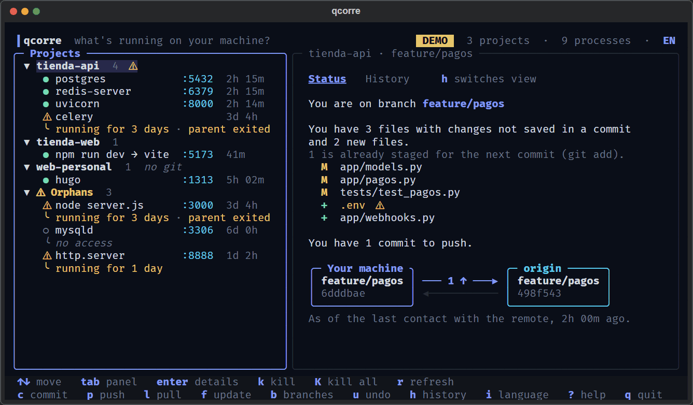
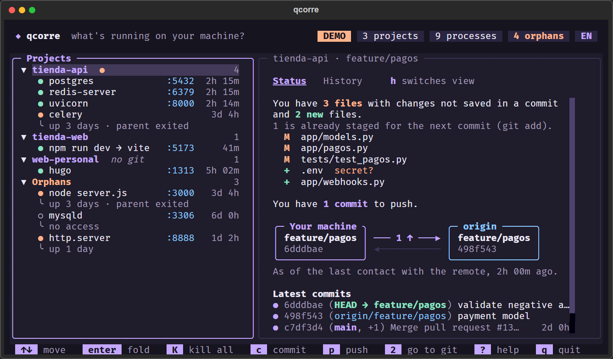
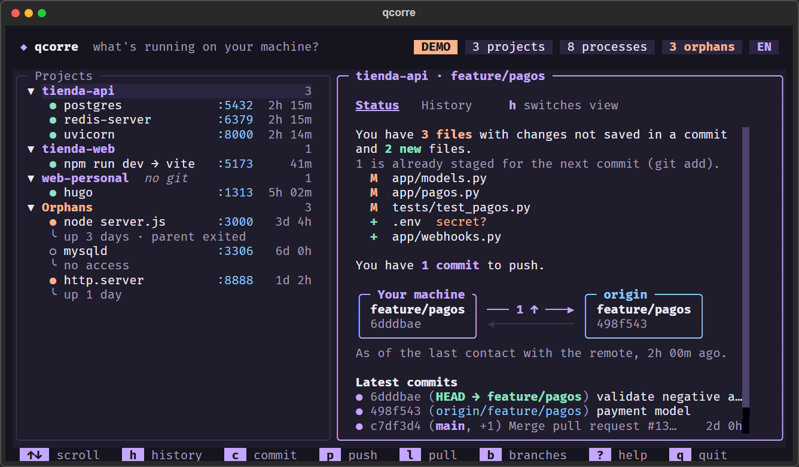
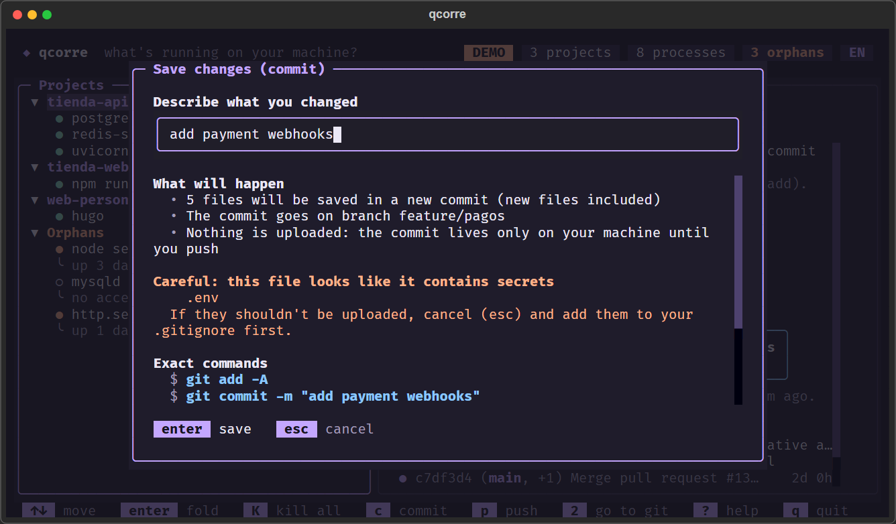
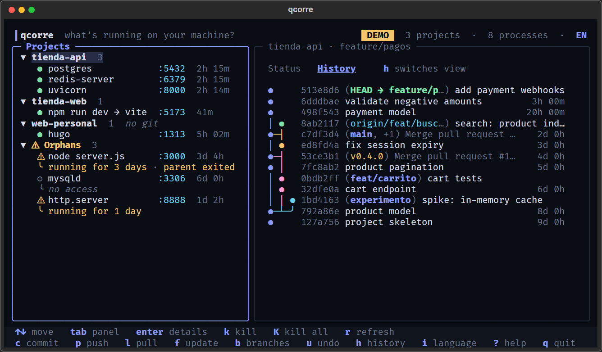

<h1 align="center">qcorre</h1>

<p align="center">
  <strong>See what's running on your machine, grouped by project — and use git in plain language.</strong><br>
  A terminal dashboard for developers. Works on Windows, macOS and Linux.
</p>

<p align="center">
  <a href="https://pypi.org/project/qcorre/"></a>
  <a href="https://github.com/BryanGEP/qcorre/actions/workflows/ci.yml"></a>
  <a href="LICENSE"></a>
  
  
</p>

<p align="center">
  English · <a href="README.es.md">Español</a>
</p>

<p align="center">
  
</p>

> *qcorre* is short for the Spanish **"¿qué corre?"** — "what's running?".

## Why qcorre?

- **"What is still using port 3000?"** Dev servers, databases and watchers pile
  up across projects. qcorre lists them by project, with their ports, so you can
  see at a glance what belongs where.
- **Forgotten processes eat ports and memory for days.** qcorre flags the
  orphans — no project, running for too long, or left behind by a closed
  terminal — and lets you kill them safely.
- **Git status reads like a riddle.** qcorre says it in plain words ("You have
  3 files with changes not saved in a commit") and draws where your machine
  stands against the remote.
- **Fear of breaking something.** Every action shows what will happen and the
  exact git command before it runs, and risky ones make a backup first.

## Features

### Processes grouped by project

<p align="center">
  
</p>

- Finds servers, databases and dev tools, with their **ports** and **uptime**,
  and groups them by the git repo or project folder they run from.
- A server and its children are **one row** — `npm run dev → vite` instead of
  three unrelated processes.
- **Orphans** are flagged with the reason: no project, running for more than a
  day, or their parent has exited.
- `enter` shows the **full command**, folder, PID, parent and start time.
- `k` kills a process and `K` every process of a project — always behind a
  confirmation that lists exactly what will be closed.

### Git status in plain language

<p align="center">
  
</p>

- **Explained status:** which branch you are on and what is not saved in a
  commit yet.
- **Your machine ↔ remote map:** how many commits you have to push and to pull,
  and how fresh that information is.
- Files that look like **secrets** (`.env`, `*.pem`, `id_rsa`…) are marked.

### Actions with a preview and a safety net

<p align="center">
  
</p>

- **Commit, push, pull, fetch, branches and undo**, each with a preview of what
  will happen and the **exact git command**. Nothing runs without confirming.
- The commit dialog lists every file going in and **warns about secrets**.
- **Branches:** switch, create, follow a remote-only branch, or delete a merged
  branch whose remote is gone.
- **Undo:** the last commit (keeping its changes), your unsaved changes, or go
  back to a backup.
- Before a risky action, a **backup** is saved under `refs/qcorre/backup/`.

### History as a branch graph

<p align="center">
  
</p>

- One line per commit: graph, hash, branches and tags, message and age.
- Each line of work gets its own lane and colour; merges and forks are drawn
  with curves.

The interface is available in **English and Spanish** (key `i`).

## Installation

You need **Python 3.10+** and **git**.

```bash
# recommended: pipx installs it in its own environment
pipx install qcorre

# or run it without installing anything permanently, with uv
uvx qcorre

# or with plain pip
pip install qcorre
```

To try the latest development version, straight from GitHub:

```bash
pipx install git+https://github.com/BryanGEP/qcorre
```

## Usage

```bash
qcorre                    # open the dashboard; the current folder's project is always listed
qcorre path/to/project    # same, pinning another project
qcorre --demo             # simulated data: try everything without touching anything real
qcorre --lang es          # force the language (en / es)
qcorre --orphan-hours 8   # flag as orphan anything running for more than 8 hours
```

> **Try it risk-free:** `qcorre --demo` opens the full interface over fake
> processes and repos that react to what you do. The GIF above was recorded
> with it.

### Keys

| Key | What it does |
|---|---|
| `↑` `↓` | Move through projects and processes |
| `tab` | Switch panel |
| `enter` | Process details (full command, folder, PID, parent) |
| `k` / `K` | Kill the process / every process of the project |
| `r` | Refresh now (it also refreshes on its own every 3 s) |
| `c` | Save the changes in a commit |
| `p` / `l` | Push / pull |
| `f` | Update from the remote (fetch) |
| `b` | Branches: switch, create (`n`) or delete a merged one (`d`) |
| `u` | Undo: the last commit, your changes, or go back to a backup |
| `h` | Toggle between status and history |
| `a` | See every changed file |
| `i` | Switch language |
| `?` | Help |
| `q` | Quit |

### How a process is matched to a project

In order: the process's working directory, the paths on its command line, the
path of its executable and, failing all that, its parent process's project. From
that folder qcorre walks up looking for a `.git`; with no repo, the nearest
folder holding a project file counts (`package.json`, `pyproject.toml`,
`Cargo.toml`, `go.mod`…).

Processes the system won't let qcorre read — common on Windows with service
processes — are still listed, marked **no access**.

## What it does and doesn't do to your repo

qcorre runs your system's `git`, so anything it does is something you could type
yourself. It is built not to surprise you.

| It does | It never does |
|---|---|
| Show the exact command before running it | Run anything without your confirmation |
| Pull only when no merge is needed (`--ff-only`) | Merge, rebase or resolve conflicts for you |
| Push your commits | Force-push |
| Delete a merged branch with `git branch -d` | Delete unmerged work (`git branch -D`) |
| Undo a commit that is still only on your machine, keeping its changes | Rewrite commits that are already on the remote |
| Back up before pull, undo, discard, restore and switching with changes | Ask for your password — if the remote needs a sign-in, it tells you |
| Read your repo without touching the index or the network | Fetch behind your back: contacting the remote is always an explicit action |

Backups are ordinary git refs. List them with
`git for-each-ref refs/qcorre/backup` and delete one with
`git update-ref -d <ref>`.

## Limitations

- No merge, rebase or conflict resolution. If your branch and the remote have
  diverged, qcorre explains it and leaves the fix to you.
- The backup of unsaved changes doesn't include new files git isn't tracking yet.
- Commit saves every change (`git add -A`); there is no per-file staging.
- Docker containers show up as Docker processes, with no project.
- A branch that was *squash*-merged on GitHub doesn't count as merged for git,
  so deleting it isn't offered.

## Contributing

Issues and pull requests are welcome.

```bash
git clone https://github.com/BryanGEP/qcorre
cd qcorre
python -m venv .venv
# Windows: .venv\Scripts\activate    macOS/Linux: source .venv/bin/activate
pip install -e ".[dev]"

pytest             # logic, git against temporary repos, and the interface
ruff check .       # lint
qcorre --demo      # the interface with simulated data
```

A few conventions:

- **Layers.** Logic is kept apart from the interface so it can be tested without
  a terminal:

  | Folder | Responsibility |
  |---|---|
  | `src/qcorre/collectors/` | Read processes and ports from the system (psutil) and close them |
  | `src/qcorre/projects/` | Decide each process's project and group them (pure logic) |
  | `src/qcorre/git/` | Read the repo, prepare and run actions, backups, history |
  | `src/qcorre/ui/` | The interface (Textual). Presentation only |
  | `src/qcorre/i18n/` | English and Spanish texts |
  | `src/qcorre/demo.py` | The simulated world behind `--demo` |

- **Two languages.** Every user-facing text goes in both `i18n/en.py` and
  `i18n/es.py`. Code comments and docstrings are written in Spanish.
- **Tests first-class.** New behaviour comes with tests; `pytest` and
  `ruff check .` must pass.
- **Commits** follow [Conventional Commits](https://www.conventionalcommits.org/).

To refresh the GIF and the screenshots after a visual change:

```bash
pip install pillow
python scripts/record_demo.py             # English
python scripts/record_demo.py --lang es   # Spanish
```

Changes are listed in the [changelog](CHANGELOG.md) (in Spanish).

## License

[MIT](LICENSE)
